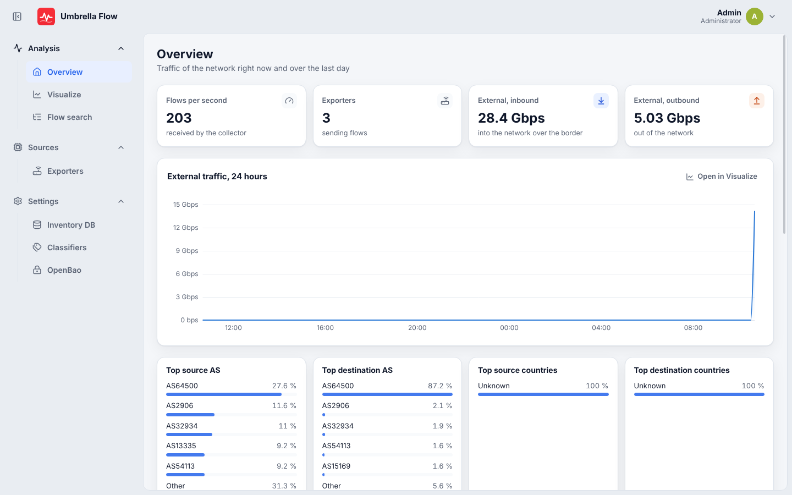
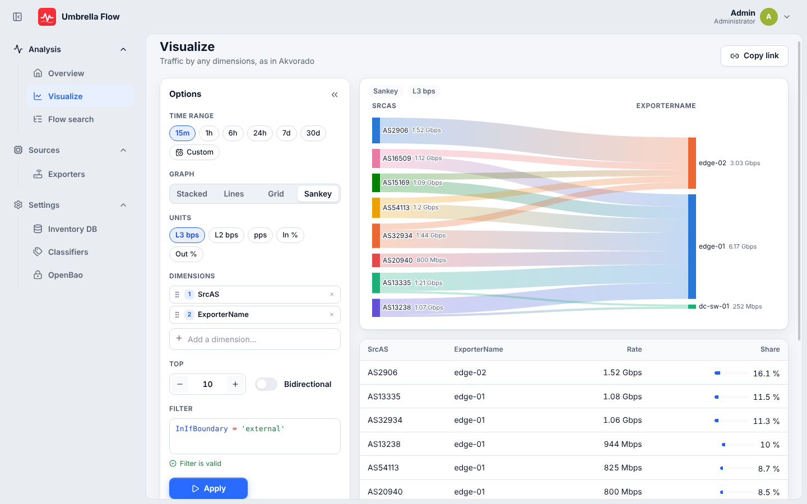
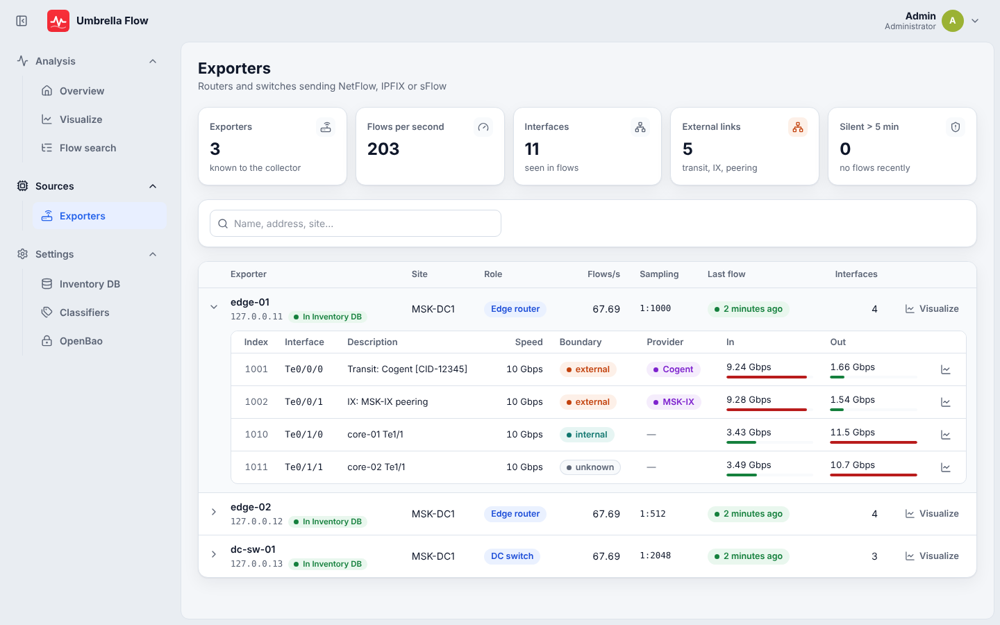
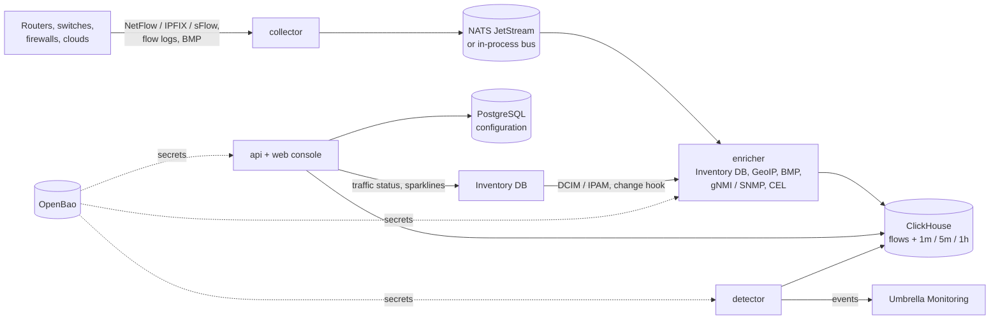

# Umbrella Flow

Network traffic analysis for NetFlow v5 / v9, IPFIX and sFlow, built into the Umbrella family:

- **[Umbrella Monitoring](https://github.com/sbrw-evc/Umbrella-Monitoring)** gets traffic incidents (link overload,
  DDoS, anomalies, silent exporters, threat contacts) on the right CI, and a "Traffic" link from every incident.
- **[Inventory DB](https://github.com/sbrw-evc/Inventory-DB)** (DCIM / IPAM) is the enrichment source: exporter
  names, sites, roles, interfaces, boundaries, providers and networks come from it with no hand-written mapping, and
  its device, interface and circuit pages show traffic from Flow.

One Go binary, a React console, flows in ClickHouse, configuration in PostgreSQL, every secret in OpenBao. It is
deployed with Docker Compose (one command) or a Helm chart, and configured in a first-run setup wizard.



## Contents

- [Key features](#key-features)
- [Architecture](#architecture)
- [Quick start (Docker)](#quick-start-docker)
- [Sending traffic to Flow](#sending-traffic-to-flow)
- [Other ways to run](#other-ways-to-run)
- [Integrations](#integrations)
- [Sign-in and access](#sign-in-and-access)
- [Security and secrets](#security-and-secrets)
- [Operations](#operations)
- [Development](#development)
- [Repository layout](#repository-layout)
- [Documentation](#documentation)
- [Troubleshooting](#troubleshooting)
- [License](#license)

## Key features

- **Every flow source in one place.** NetFlow v5 / v9, IPFIX, sFlow v5 and cloud flow logs (AWS, Azure, GCP), with
  sampling rates learned from option templates or set per exporter and interface.
- **Flows that already know the network.** Each flow carries the exporter's site and role, interface names and
  speeds, internal / external boundary, provider, network, tenant and CI, taken from Inventory DB and kept in sync
  through a signed change hook.
- **Routing and device data.** A built-in BMP receiver adds AS paths, communities and next hops (including VPN, labeled
  unicast and EVPN routes); gNMI and SNMP fill interface data for devices outside Inventory DB.
- **More context per address.** GeoIP and ASN, applications by port, reverse DNS, threat intelligence from public
  blocklists, and custom CEL classifiers with a live preview.
- **Answers in a few clicks.** Visualize by any dimension as stacked, lines, grid or sankey graphs, in and out on one
  graph, bps / pps / % utilisation and the 95th percentile, with a filter language that completes as you type
  (`SrcAS = 65000 AND InIfBoundary = external`), saved views and shareable links; raw flow search; an overview of what
  needs attention.
- **Incidents, not just graphs.** Rules for link utilisation, circuit commit, volumetric and SYN DDoS, baseline
  anomalies, traffic drops, silent exporters and threat contacts raise Umbrella incidents on the right CI and resolve
  them when traffic is back to normal.
- **Traffic where engineers already look.** Traffic chips, sparklines and circuit 95th percentile in Inventory DB, a
  "Traffic" link from Umbrella incidents, per-interface metrics on `/metrics` and a "CI traffic" dashboard.
- **CMDB from real traffic.** Steady CI-to-CI flows become dependency proposals on Umbrella's CMDB map.
- **Fast storage, long history.** Raw flows plus 1 min / 5 min / 1 h aggregates in ClickHouse, with the resolution
  picked for the requested period and separate retention for each level.
- **Sign-in and access are managed in [SPA](https://github.com/sbrw-evc/SPA-Single-point-of-authorization-).** People sign in through SPA, the Single Point of
  Authorization of the Umbrella family (passwords, passkeys, LDAP / AD, Entra ID, Google, Apple and OpenID Connect
  live there); Flow reads its people and their roles from SPA and publishes its own roles to it
  ([docs/identity-federation.md](docs/identity-federation.md)).
- **Secure by default.** Every secret in OpenBao, no passwords kept in Flow, page-level roles,
  visibility limited to a user's Umbrella services, API tokens and an audit log.
- **Up in one command.** One image for every role, a Docker Compose stack or a Helm chart, a first-run setup wizard
  with a check at every step, horizontal scaling by role.
- **Russian and English UI**, light and dark themes, a phone layout.

| Visualize (sankey) | Exporters |
|---|---|
|  |  |

## Architecture



The same binary runs every role: `all` (default, one container for small and medium installs), or `collector`,
`enricher`, `detector` and `api` as separate processes for load, connected by NATS JetStream. Collectors scale behind a
UDP load balancer, enrichers as a JetStream consumer group.

| Component | Choice |
|---|---|
| Backend | Go 1.26, own BMP / BGP decoder, CEL, pgx, goose |
| Web console | React 19, TypeScript, Vite, TanStack Query, react-router 7, Apache ECharts, CodeMirror 6 |
| Flow storage | ClickHouse 25.8 LTS (raw flows 15 days, aggregates 30 days / 90 days / 2 years by default) |
| Configuration | PostgreSQL 17 |
| Bus | NATS JetStream 2.11 (optional in role `all`) |
| Secrets | OpenBao 2.7 (KV v2, AppRole) |
| Dashboards | Grafana 13 with the ClickHouse datasource |

Details and the reasoning behind each choice: [docs/plan.md](docs/plan.md).

## Quick start (Docker)

You need Docker with Compose v2 (Docker Engine on Linux, or Docker Desktop on macOS / Windows), about 6 GB of memory
for the containers (ClickHouse alone is limited to 4 GB) and a few GB of disk.

```sh
git clone https://github.com/sbrw-evc/Umbrella-Flow.git
cd Umbrella-Flow/deploy/flow
cp .env.example .env
# Edit .env: set POSTGRES_PASSWORD, CLICKHOUSE_PASSWORD, NATS_TOKEN and CLICKHOUSE_GRAFANA_PASSWORD
docker compose --profile demo up -d --build
docker compose logs flow | grep setup_code
```

The first start builds the `umbrella-flow` image from `app/` and starts Flow, PostgreSQL, ClickHouse, NATS and
OpenBao. `openbao-init` initialises and unseals OpenBao, creates the `flow` mount and AppRole and copies the
passwords from `.env` into it. `--profile demo` adds a container that sends synthetic NetFlow v9, IPFIX and sFlow
traffic; leave it out for a real installation.

Then:

1. Open <http://localhost:8080> (or `http://<host>:8080`).
2. Enter the setup code from the log.
3. Click through the wizard: OpenBao, PostgreSQL, ClickHouse and NATS are prefilled for the bundled services.
   Inventory DB, Umbrella and GeoIP are optional and can be set later in the console.
4. Paste the SPA connection key (or set `SPA_CONNECTION_KEY` in `.env`, see [Sign-in and access](#sign-in-and-access)).
   The wizard writes `flow.json` to the `flow-data` volume and opens the sign-in page; whoever SPA gives Flow's
   `admin` role administers Flow.

With the demo profile the graphs fill within a minute: three exporters (`edge-01`, `edge-02`, `dc-sw-01`) appear on the
Exporters page and in Visualize.

**On a host that already runs Umbrella Monitoring**, its OpenBao already holds port 8200: set `OPENBAO_PORT=8201`
(or another free port) in `.env` before the first start. Check the other published ports the same way (8080, 8123,
3000, 2055 and 6343).

**Keep `deploy/flow/secrets/openbao/init.txt` safe.** It holds OpenBao's unseal keys and root token; without it the
secrets, and so the installation, cannot be recovered.

Useful profiles and files:

| Command | What it adds |
|---|---|
| `docker compose --profile demo up -d` | synthetic traffic generator |
| `docker compose --profile geoip up -d` | MaxMind GeoLite2 updates (`GEOIPUPDATE_*` in `.env`, then `FLOW_GEOIP_DATABASES`) |
| `docker compose --profile grafana up -d` | Grafana with the "CI traffic" dashboard on <http://localhost:3000> |
| `COMPOSE_FILE=docker-compose.yml:docker-compose.umbrella.yml` in `.env` | joins the shared `umbrella` network with Umbrella Monitoring and Inventory DB |

From `app/` the same is `make stack` and `make stack-demo`. The full Docker guide (ports, secrets, upgrades, backups):
[deploy/flow/README.md](deploy/flow/README.md).

## Sending traffic to Flow

| Port | Protocol | What |
|---|---|---|
| 8080 | TCP | web console, API, `/metrics`, `/healthz` |
| 2055 | UDP | NetFlow v5 / v9, IPFIX |
| 6343 | UDP | sFlow v5 |
| 10179 | TCP | BMP, listened to only after it is enabled under Data collection → BMP routing |

Point the exporters at the Docker host, from a stable source address (a loopback): Flow identifies an exporter by the
source address of its datagrams and matches it to the Inventory DB device by its primary IP. Export the interface and
sampler option templates so Flow learns interface names and sampling rates. Configuration examples for Cisco IOS XE /
IOS XR, Junos and sFlow switches are in [deploy/flow/README.md](deploy/flow/README.md#pointing-routers-at-flow).

Cloud flow logs are posted to `/api/ingest/flowlogs/{aws,azure,gcp}`; the Data collection → Cloud flow logs page shows
the URLs, tokens and setup snippets for each provider.

## Other ways to run

**Kubernetes.** The Helm chart in [deploy/helm/umbrella-flow](deploy/helm/umbrella-flow/README.md) runs Flow as one
Deployment or one Deployment per role, against external ClickHouse, PostgreSQL, NATS and OpenBao
(`--set dev.enabled=true` bundles throwaway ones for evaluation).

**From source**, with Go 1.26+, Node.js 22, PostgreSQL 17, ClickHouse 25.8 and OpenBao (NATS optional):

```sh
cd app
make openbao-dev          # OpenBao dev server in Docker: address http://127.0.0.1:8200, token dev-root, mount flow
make build && make run    # http://localhost:8080, the setup code is in the log
make demo                 # synthetic traffic to 127.0.0.1:2055
```

Single-host and split-role walkthroughs: [app/README.md](app/README.md#run).

## Integrations

| With | What happens | Where it is set up |
|---|---|---|
| Inventory DB → Flow | exporters, interfaces, circuits, prefixes and CIs enrich every flow; a signed hook triggers an early sync on changes | wizard step or Integrations → Inventory DB |
| Flow → Inventory DB | traffic chips, 24 h sparklines and circuit 95th percentile on device, interface and circuit pages; live addresses missing from IPAM | Inventory DB integration `kind: flow` with a Flow API token |
| Flow → Umbrella | detector events become incidents on the right CI, with a "Traffic" link back to Flow | Umbrella quick connect `network-flow`, then wizard step or Integrations → Umbrella Monitoring |
| Umbrella → Flow | users see only the flows of their Umbrella services; steady CI ↔ CI traffic becomes CMDB relation proposals | Umbrella service-account token under Integrations → Umbrella Monitoring |
| Grafana | "CI traffic" dashboard with the same `var-ci` variables as Umbrella's Grafana links | `--profile grafana`, or import into an existing Grafana |

Contracts between the three applications: [docs/integrations.md](docs/integrations.md). Grafana:
[deploy/grafana/README.md](deploy/grafana/README.md).

## Sign-in and access

Sign-in and access are managed in **SPA**, the Single Point of Authorization of the Umbrella family
([repository](https://github.com/sbrw-evc/SPA-Single-point-of-authorization-), contract: [docs/protocol.md](https://github.com/sbrw-evc/SPA-Single-point-of-authorization-/blob/main/docs/protocol.md)). Flow keeps no
passwords, password policy, passkeys or directory settings; it has no sign-in form and no first administrator of its
own.

To connect Flow:

1. In SPA: **Applications → Connect an application**, type `umbrella-flow`, the address of Flow. The redirect address
   is `<address>/api/auth/spa/callback`, the address after sign-out `<address>/`.
2. On the **Access** step assign Flow's roles (`admin`, `viewer` and the custom roles Flow publishes) to people and
   groups.
3. Give Flow the **connection key** (`spa1.…`) SPA shows: `SPA_CONNECTION_KEY`, a file named by
   `SPA_CONNECTION_KEY_FILE`, or the setup wizard (kept in OpenBao at `spa#connection_key`). Set `SPA_PUBLIC_URL` when
   Flow is reached under another address than the request's.

Flow then sends people to SPA to sign in, synchronizes its users every 5 minutes (Settings → SPA → Synchronize now),
disables people SPA disables or removes (their sessions and API tokens stop working) and publishes its role catalogue
whenever its roles change. Password and passkeys: user menu → **Account and security** (SPA). Details:
[docs/identity-federation.md](docs/identity-federation.md).

## Security and secrets

- OpenBao is the only secret store. Database passwords, Inventory DB and Umbrella tokens, the SPA connection key
  (when given in the wizard) and session keys live there; PostgreSQL and `flow.json` keep only
  `openbao://mount/path#key` references. Flow keeps no passwords: people sign in through SPA.
- Flow signs in to OpenBao with AppRole and caches reads for 30 s, so a rotation in OpenBao needs no restart.
- The API never returns a secret (only a `*_set` flag), and secrets never reach logs or the audit log.
- `.env` in the Docker stack holds only bootstrap passwords for the bundled service containers; the `flow` container
  never sees them.
- Sessions are HttpOnly cookies with CSRF protection, started after the SPA sign-in (OpenID Connect with PKCE S256, a
  nonce and a signed single-use state); API tokens are stored as HMACs, shown once and stop working when SPA disables
  the person who issued them.
- Behind an HTTPS reverse proxy set `FLOW_SECURE_COOKIES=true` and `FLOW_TRUSTED_PROXIES`.
- BMP is unauthenticated: limit who can reach TCP 10179 and list the allowed routers in the BMP settings.

The full list of OpenBao paths: [app/README.md](app/README.md#secrets).

## Operations

- Health: `docker compose ps` (every service has a healthcheck) and `curl http://localhost:8080/healthz`.
- Component status: `GET /api/status` (collector, bus, enricher, writer, Inventory DB sync, detector and the optional
  sources).
- Metrics: Prometheus format on `http://<host>:8080/metrics` (`flow_*`, plus per-interface utilisation).
- Logs: `docker compose logs -f flow`.
- Upgrade: `git pull && docker compose up -d --build`; PostgreSQL and ClickHouse migrations run on start. Back up
  first.
- Backup: PostgreSQL (`pg_dump`), ClickHouse (`BACKUP DATABASE`), an OpenBao raft snapshot together with
  `secrets/openbao/init.txt`, and the `flow-data` volume. Commands:
  [deploy/flow/README.md](deploy/flow/README.md#backup-and-restore).

## Development

```sh
cd app
make dev-api              # backend on :8080 (go run)
make dev-web              # Vite dev server on :5173
cd web && npm run dev:mock   # console against the built-in mock server, no backend needed
make test                 # go vet, go test, web typecheck and Vitest
make fmt                  # gofmt
make image                # Docker image umbrella-flow:<version>
```

Backend tests use real PostgreSQL on `localhost:5432` (`postgres` / `postgres`) and ClickHouse on `localhost:9000`;
`FLOW_TEST_POSTGRES=off` and `FLOW_TEST_CLICKHOUSE=off` skip those tests. OpenBao is faked.
`FLOW_TEST_E2E=1 go test ./internal/wiring` runs the whole pipeline in one process.

CI ([.github/workflows/ci.yml](.github/workflows/ci.yml)) runs on every pull request: `gofmt`, `go vet`,
`go test -race` against PostgreSQL and ClickHouse, the web typecheck, tests and build, the Compose configuration
checks and the image build. Work goes to a branch from `main` and is merged by pull request once CI is green.

Conventions: documentation and code comments are in English, the UI is bilingual (RU / EN). Dependencies must be
open source with permissive licences.

## Repository layout

```
app/
  backend/          Go: cmd/flow (entry point, roles) and internal/ packages (collector, bus, enrich, bmp,
                    gnmi, snmp, query, detector, setup, auth, secrets, store, …)
  web/              React console
  docs/screens/     screenshots
  Dockerfile        one image for every role (distroless, non-root)
  Makefile
deploy/
  flow/             Docker Compose stack: Flow, PostgreSQL, ClickHouse, NATS, OpenBao (+ demo, geoip, grafana)
  helm/umbrella-flow/  Helm chart
  grafana/          "CI traffic" dashboard and provisioning
docs/
  plan.md           goals, architecture, stack and stages
  api.md            REST API contract
  integrations.md   contracts with Umbrella Monitoring and Inventory DB
```

## Documentation

| Document | What is in it |
|---|---|
| [app/README.md](app/README.md) | what each part does, secrets, running from source, environment variables, package layout |
| [deploy/flow/README.md](deploy/flow/README.md) | Docker deployment: services, ports, router configuration, upgrades, backups |
| [deploy/helm/umbrella-flow/README.md](deploy/helm/umbrella-flow/README.md) | Kubernetes: roles, values, services |
| [deploy/grafana/README.md](deploy/grafana/README.md) | the "CI traffic" dashboard |
| [docs/plan.md](docs/plan.md) | plan, architecture, data model, stack |
| [docs/api.md](docs/api.md) | REST API |
| [docs/integrations.md](docs/integrations.md) | cross-application contracts |

## Troubleshooting

| Symptom | What to check |
|---|---|
| No `setup_code` in the log | Flow waits for its dependencies: `docker compose ps` must show `openbao-init`, `postgres`, `clickhouse` and `nats` healthy. The code is also kept in the `flow-data` volume (`/data/setup-token`), and `FLOW_SETUP_TOKEN` sets a fixed one. |
| `clickhouse` keeps restarting | not enough memory for the container: give Docker more memory or lower `CLICKHOUSE_MEMORY_LIMIT` in `.env`. |
| Port 8080, 2055 or 6343 is busy | change `FLOW_HTTP_PORT`, `FLOW_NETFLOW_PORT` or `FLOW_SFLOW_PORT` in `.env`. |
| `openbao` fails with "port is already allocated" | another OpenBao or Vault (often Umbrella Monitoring's) uses 8200 on the host: set `OPENBAO_PORT=8201` in `.env`. The port is only for the OpenBao UI on the host; Flow reaches OpenBao inside the Compose network either way. |
| `nats` stays unhealthy, log shows a parse or nil pointer error | older checkouts read an all-digit `NATS_TOKEN` (such as `12345`) as a number: `git pull`, or use a token with a letter in it. |
| Flow joined to the `umbrella` network talks to the wrong database | an installation set up before the `flow-*` host aliases has `postgres`, `clickhouse`, `nats` and `openbao` as hosts, and Umbrella's containers may answer to the same names. Change them to `flow-postgres`, `flow-clickhouse`, `flow-nats` and `flow-openbao` in `flow.json` (the `flow-data` volume) and restart `flow`, or stay off the shared network. |
| Exporters show up under the wrong address | something between the router and Flow rewrites the UDP source address (NAT, a load balancer with SNAT). Keep the original source; on Linux the default Docker setup does. |
| Flows arrive but without names, sites or boundaries | connect Inventory DB (Integrations → Inventory DB) and check that each exporter's source address is the device's primary IP. |
| Graphs show bytes too low | the exporter does not report its sampling rate: set it on the Exporters page. |
| OpenBao is sealed after a host restart | `OPENBAO_AUTO_UNSEAL=true` (default) unseals it with the keys in `secrets/openbao/init.txt`; check that the file is still there. |

## License

Proprietary. See [LICENSE](LICENSE).
