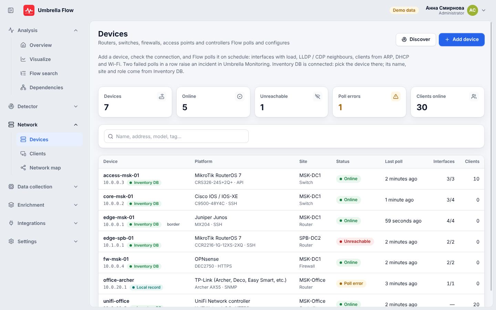
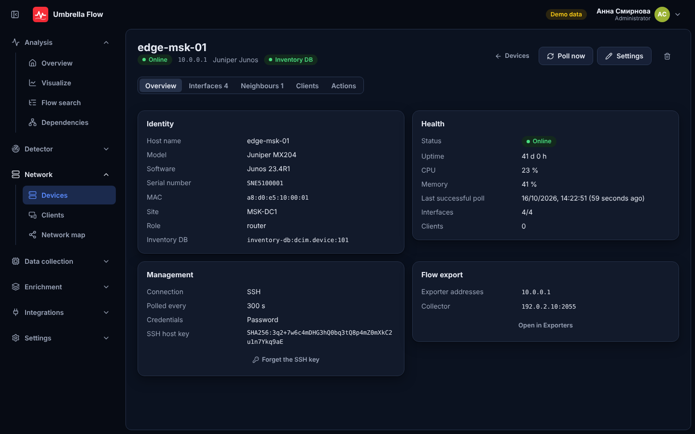
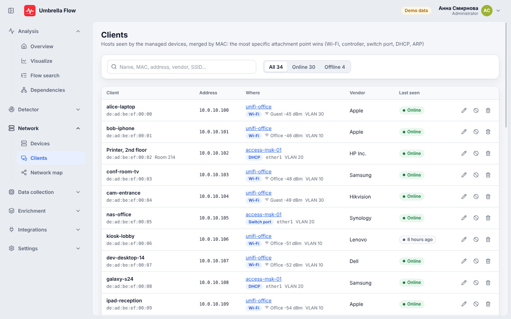
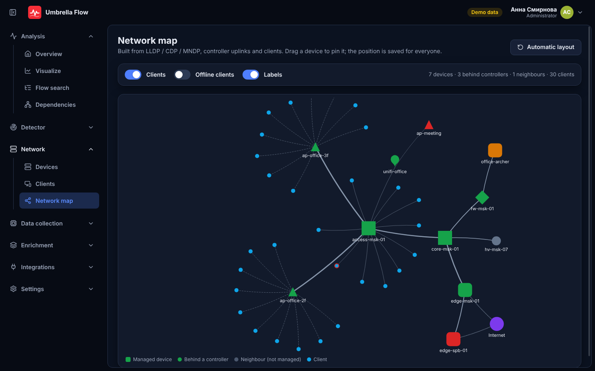

# Network devices

Flow manages the network equipment it receives flows from. It keeps a registry of devices, polls them on a schedule
and shows their interfaces, neighbours and clients. It also applies a few settings on them (name, interfaces, DNS, NTP,
flow export) and draws a network map. The module is a port of Network Control's device management. Its code is in
`app/backend/internal/devices` (service, poller, clients, map) and `internal/devices/drivers` (platform drivers). In
the console it lives in the **Network** group: **Devices**, **Clients** and **Map**.

The REST API is documented in [api.md](api.md#network-devices).

| Devices | Device |
|---|---|
|  |  |
| **Clients** | **Network map** |
|  |  |

## Inventory DB is the source of truth

There is one record per real device and never a duplicate:

- **With Inventory DB connected** (Integrations → Inventory DB), "Add device" lists only the Inventory DB devices
  that Flow does not manage yet (`GET /api/devices/inventory-candidates`). The new record binds to that device
  (`inventory_id`, `source_ref` = `inventory-db:dcim.device:<id>`). Its name, site and role come from Inventory DB on
  every refresh and cannot be edited in Flow. A device can be bound only once. Unbinding is refused.
- **Without Inventory DB**, a device is a standalone record with its own name, site and role.
- In both cases, one address (plus controller site) is one device. A second record for the same address is refused
  with 409 `duplicate_device`.
- When an Inventory DB device disappears, the record is kept and marked `inventory_missing`.

## Platforms

28 platform families from Network Control plus a generic gNMI driver. The default transport is listed first.
"Actions" are what **Apply** can change on the device (see below); every platform is also polled.

| Key | Platform | Transports | Actions |
|---|---|---|---|
| `mikrotik` | MikroTik RouterOS 7 | REST API 443, HTTP 80, SSH 22, SNMP | hostname, interface, dns, ntp, flow_export, reboot, command, backup |
| `tplink_jetstream` | TP-Link JetStream / Omada switch (standalone) | SSH, SNMP | hostname, interface, ntp, reboot, command, backup |
| `tplink` | TP-Link (Archer, Deco, Easy Smart, etc.) | SNMP | hostname, interface |
| `omada` | TP-Link Omada SDN Controller | HTTPS 8043, HTTP 8088 | endpoint_block, reboot |
| `opnsense` | OPNsense | HTTPS, HTTP, SNMP | flow_export, reboot, backup |
| `pfsense` | pfSense | HTTPS, HTTP, SNMP | hostname, dns, reboot, command, backup |
| `openwrt` | OpenWrt (GL.iNet, Turris, Cudy, etc.) | SSH, SNMP | hostname, interface, dns, ntp, flow_export, reboot, command, backup |
| `keenetic` | Keenetic | HTTP, HTTPS | hostname, interface, dns, ntp, endpoint_block, reboot, command, backup |
| `cisco_ios` | Cisco IOS / IOS-XE | SSH, SNMP | hostname, interface, dns, ntp, flow_export, reboot, command, backup |
| `cisco_nxos` | Cisco NX-OS | SSH, SNMP | hostname, interface, dns, ntp, reboot, command, backup |
| `meraki` | Cisco Meraki Dashboard | HTTPS | reboot |
| `unifi` | Ubiquiti UniFi Network | HTTPS | endpoint_block, reboot |
| `edgeos` | Ubiquiti EdgeRouter / VyOS | SSH, SNMP | hostname, interface, reboot, command |
| `zyxel` | Zyxel switches and USG / ATP / USG FLEX | SSH, SNMP | hostname, interface, ntp, reboot, command, backup |
| `aruba_os` | HP ProCurve / HPE Aruba ArubaOS-Switch | SSH, SNMP | hostname, interface, dns, ntp, flow_export, reboot, command, backup |
| `aruba_cx` | HPE Aruba AOS-CX | SSH, SNMP | hostname, interface, dns, ntp, reboot, command, backup |
| `hp_comware` | HPE FlexNetwork / OfficeConnect / H3C (Comware) | SSH, SNMP | hostname, interface, dns, ntp, flow_export, reboot, command, backup |
| `dell_os10` | Dell EMC PowerSwitch (OS10) | SSH, SNMP | hostname, interface, dns, ntp, reboot, command, backup |
| `dell_nseries` | Dell PowerSwitch N / PowerConnect | SSH, SNMP | hostname, interface, dns, ntp, reboot, command, backup |
| `juniper` | Juniper Junos | SSH, SNMP | hostname, interface, dns, ntp, reboot, command, backup |
| `huawei` | Huawei VRP | SSH, SNMP | hostname, interface, dns, ntp, reboot, command, backup |
| `fortigate` | Fortinet FortiGate | HTTPS, SNMP | hostname, interface, dns, ntp, flow_export, reboot, backup |
| `eltex` | Eltex MES | SSH, SNMP | hostname, interface, dns, ntp, reboot, command, backup |
| `redfish` | Dell iDRAC, HPE iLO, Lenovo XCC, Supermicro (Redfish) | HTTPS | hostname, reboot |
| `linux` | Linux / Proxmox / Synology / ASUS Merlin | SSH, SNMP | hostname, interface, reboot, command |
| `netgear` | Netgear | SNMP | hostname, interface |
| `dlink` | D-Link | SNMP | hostname, interface |
| `snmp` | Any device (SNMP v1 / v2c / v3) | SNMP | hostname, interface |
| `gnmi` | Any device (gNMI, OpenConfig) | gNMI (port of the gNMI profile) | none (read only) |

Over SNMP, any SSH or API platform falls back to the actions SNMP can do (`hostname`, `interface`).
`GET /api/devices/platforms` returns the same table with the credential fields of each transport.

What a poll collects (where the platform has it): facts (model, OS, version, serial, uptime, CPU, memory),
interfaces with counters and computed rates, LLDP / CDP neighbours, and clients from ARP, DHCP leases, the bridge
table and Wi-Fi associations. Controllers (`omada`, `unifi`, `meraki`) also return the access points and switches
they manage as children.

**SSH host keys** are pinned on the first connection (trust on first use). A changed key fails the poll until
someone with `devices:edit` resets it (`POST /api/devices/{id}/reset-host-key`).

**Discovery** (`POST /api/devices/discover`) probes an address, a host name or a subnet up to /22 over SNMP, SSH
and HTTP(S), and suggests a platform for each answer. **OUI lookup** names the vendor of a client's MAC from the
IEEE registry. The registry is cached under `<data dir>/devices` and refreshed in the background.

## Credentials

Credentials are kept only in OpenBao, mount `flow`, path `devices/<id>`. PostgreSQL holds none. The API never
returns a secret. It tells only which fields are set (`credentials.set.<field>`). An empty secret in an update keeps
the stored value, and `clear_credentials` removes a field.

For SNMP there are two sources:

- **own**: the device's own community or v3 user, stored in OpenBao.
- **profile**: the Flow SNMP profile that matches the device address (Settings → SNMP), so one profile serves the
  device manager and the enricher's interface names.

The `gnmi` platform always uses the gNMI profile that matches its address. A device's own SNMP credentials also
feed the SNMP interface-name fallback for its exporter addresses. They become a `dev-<id>` profile ahead of the
configured ones, and SNMP polling of exporters is switched on for those addresses even when it is off in the settings.

## Polling

- Each device has its own interval, `poll_seconds` from 60 to 86400 (default 300). "Poll now" runs one at once (409
  `poll_running` while one is in progress).
- A scheduler ticks every 15 seconds. It runs only on the instance that holds the PostgreSQL advisory lock
  `devices-poll`, so several API replicas poll each device once.
- Polls run in parallel up to the `concurrency` setting (default 6). One poll takes at most 3 minutes; an action
  takes at most 5 minutes.
- After a failed poll the device is `error`. After **two failed polls in a row** it is `down`, and a poll that
  succeeds again brings it back to `up`.
- Every hour the scheduler forgets unnamed clients not seen for `endpoint_retention_days` (default 90) and refreshes
  the OUI registry.

Settings (`GET/PUT /api/devices/settings`): `collector_address`, `netflow_port`, `sflow_port`,
`endpoint_offline_minutes` (a client is offline after, default 15), `endpoint_retention_days`, `concurrency`.

## Actions

`POST /api/devices/{id}/actions` with `{action, params}`:

| Action | Permission | What it does |
|---|---|---|
| `hostname` | `devices:operate` | sets the device's host name |
| `interface` | `devices:operate` | enables or disables an interface, sets its description |
| `dns` | `devices:operate` | sets DNS servers |
| `ntp` | `devices:operate` | sets NTP servers |
| `flow_export` | `devices:operate` | turns on NetFlow / IPFIX or sFlow towards **Flow's own collector**: by default the address from the settings (else the host of the public URL) and the collector's NetFlow / sFlow port |
| `reboot` | `devices:admin` | reboots the device |
| `command` | `devices:admin` | runs a command and returns its output |
| `backup` | `devices:admin` | saves the configuration; `GET /api/devices/{id}/backup` downloads the last one |

Blocking a client (`POST /api/endpoints/{mac}/block`, `devices:operate`) runs on the device that sees it, where that
device supports `endpoint_block` (Keenetic, Omada, UniFi). After a non-admin action, the device is polled again
3 seconds later.

## Clients

Each poll records what the device sees (sightings). Sightings are merged into one client per MAC address. When
sources disagree, the strongest one wins:
Wi-Fi association (5) > controller (4) > bridge table (3) > DHCP lease (2) > ARP (1).
Only sightings from the last 30 minutes are merged.

People with `devices:edit` can give a client a name and a note, or forget it. Infrastructure MACs (managed devices
and their interfaces) are left out of the list.

## Network map

`GET /api/topology` builds a graph with these nodes:

- managed devices;
- their children (access points and switches behind controllers);
- LLDP / CDP neighbours that Flow does not manage;
- optionally, the clients (online only, or also the offline ones).

Links carry the utilisation of the interface when it is known. The **Map** page draws the graph with ECharts. With
`devices:edit` a person can drag devices, and the positions are saved for everyone (`PUT /api/topology/positions`).
**Reset layout** clears them. A double click opens the device.

## Events in Umbrella Monitoring

Flow adds no alert table of its own and sends nothing to Telegram. A device going down or coming back is an event
for Umbrella Monitoring. The event goes through the same sender as the detector (`detector.Sender`, the Umbrella
`network-flow` connector), with:

- `signal: use.device.down`, `method: USE`, `severity: critical`;
- `ci` = the device name and `source_ref` = `inventory-db:dcim.device:<id>`, so Umbrella puts the incident on the CI
  of the Inventory DB device (a standalone device has no `source_ref` and matches by name and IP);
- labels `device_id`, `platform`, `host`, `site`, `role` and `error`;
- a `links.flow` link to the device page in Flow when the public URL is set.

The event is sent `firing` when the device is `down` and `resolved` when it is up again (or disabled or deleted).
Each down episode has its own event id, so a new outage opens a new incident. When Umbrella is not configured, no
event is kept back for later. See [integrations.md](integrations.md#31-events-done).

## Exporters

An exporter whose address matches a managed device (its host or `flow_exporter_ip`) shows that device on Data
collection → Exporters, with a link to it (`device` in `GET /api/exporters`). The device page shows its exporter
addresses with a link back to Exporters.

## Permissions

| Permission | Allows |
|---|---|
| `devices:view` | the pages Devices, Clients and Map, every read route |
| `devices:edit` | add, change, delete, test the connection, discover, reset a host key, name and forget clients, arrange the map, settings |
| `devices:operate` | Poll now and the actions `hostname`, `interface`, `dns`, `ntp`, `flow_export`, client blocking |
| `devices:admin` | the actions `reboot`, `command`, `backup` and the configuration download, plus everything of `devices:operate` |

They are part of the access catalogue that Flow publishes to SPA (Settings → Roles). Every change and action is
written to the audit log (`device.*`, `endpoint.*`), without secrets.
