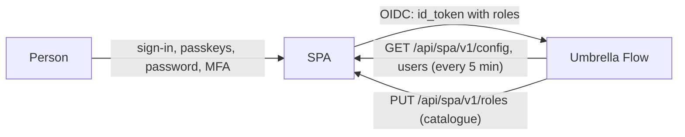

# Sign-in and access: SPA, the Single Point of Authorization

**Sign-in and access to Umbrella Flow are managed in SPA**
([sbrw-evc/SPA-Single-point-of-authorization-](https://github.com/sbrw-evc/SPA-Single-point-of-authorization-)), the
one place where people of the Umbrella family authenticate and where their access is decided. The contract is SPA's
[docs/protocol.md](https://github.com/sbrw-evc/SPA-Single-point-of-authorization-/blob/main/docs/protocol.md); this
document describes Flow's side of it.

Flow keeps **no passwords, no password policy, no passkeys and no directory or provider settings** (LDAP / AD,
Entra ID, Google, Apple, OpenID Connect): they live in SPA. Flow

1. sends people to SPA to sign in (OpenID Connect, authorization code flow with PKCE);
2. reads the people who may use it and their roles from SPA (the federation API) every five minutes;
3. publishes its role catalogue to SPA, so that SPA administrators assign its roles;
4. enforces the permissions of those roles (`<page>:<function>`, `GET /api/access/catalog`).



## Connecting Flow

1. In SPA: **Applications → Connect an application**, type `umbrella-flow`, the address of Flow. The redirect address
   is `<address>/api/auth/spa/callback`, the address after sign-out `<address>/`.
2. **Access**: give Flow's roles to people and groups. People without a role in Flow cannot sign in to it.
3. **Connection key**: SPA shows `spa1.<base64url JSON {issuer, client_id, client_secret, token}>` once. Give it to Flow
   in one of these ways (the first one present wins):
   - `SPA_CONNECTION_KEY` (Docker: `.env`; Helm: `spa.connectionKeySecret`);
   - a file named by `SPA_CONNECTION_KEY_FILE`;
   - the setup wizard's SPA step, which keeps it in OpenBao at `spa#connection_key`.

   `SPA_PUBLIC_URL` sets the address of Flow for the redirect addresses when it differs from the request address
   (otherwise the request's, with `X-Forwarded-Proto` / `X-Forwarded-Host` from `FLOW_TRUSTED_PROXIES`).

A Flow without a key shows "This application is not connected to SPA" with these instructions instead of a sign-in
button. There is no first administrator of Flow's own: the first administrator is whoever SPA gives Flow's `admin`
role.

## Sign-in

- The sign-in page has one button, **Sign in with SPA**, and goes to SPA by itself when the person arrives without a
  session — unless they were just signed out or SPA sent an error back (`/login?sso_error=…`, shown on the page).
- `GET /api/auth/spa/start?return=<path>` creates the state, the nonce and the PKCE verifier. The state is signed
  (HMAC with `keys#state` in OpenBao), carries the return path and expires after 10 minutes; it is accepted once. The
  verifier and the nonce go to the HttpOnly cookie `flow_spa` (`SameSite=Lax`, path `/api/auth/spa/`, 10 minutes,
  `Secure` on https). The request asks `scope=openid profile email groups roles`, `code_challenge_method=S256` and may
  pass `login_hint`, `idp_hint` and `prompt=login`.
- `GET /api/auth/spa/callback` checks the state against the cookie, redeems the code with the verifier and verifies the
  ID token: RS256 signature from SPA's JWKS, `iss` = the issuer of the key, `aud` = the client ID, `exp`, `nonce`. It then
  finds the user bound to `sub` (never by e-mail), or creates it from the claims, sets the user's role from `roles` and
  starts Flow's own session (`flow_session`, 12 h idle, 7 days at most).
- **Sign out** ends Flow's session and goes to SPA's sign-out (`sign_out_url?post_logout_redirect_uri=<address>/&client_id=…`).
- The user menu's **Account and security** opens SPA's `account_url`: the password and the passkeys are changed there.

## Users

Every five minutes (one replica at a time, a PostgreSQL advisory lock) and on **Settings → SPA → Synchronize now**:

- `GET /api/spa/v1/config` (with its ETag): application, sign-in methods, `account_url`, `sign_out_url`;
- `GET /api/spa/v1/users` (with its ETag): each person is created or updated (`source = spa`, `external_id` = the SPA
  user ID) with user name, name, e-mail and role;
- a person who is `disabled`, has no role Flow knows, or is missing from the list is disabled; their sessions end and
  the API tokens they issued stop working.

Accounts made before Flow moved to SPA keep their IDs (saved views, tokens, audit) as `legacy` accounts: the first SPA
sign-in or synchronization binds one to the SPA person with the same user name, once; from then on only the SPA user
ID counts. A legacy account no SPA person claims is disabled by the first successful synchronization.

**Settings → Users** is read-only ("Managed in SPA"): creating people, roles, enabling and disabling them is done in
SPA. What is not identity stays in Flow: saved views, service accounts and API tokens.

## Roles

Flow publishes its roles as SPA's catalogue (`PUT /api/spa/v1/roles`) at start, at every synchronization when they
changed, and whenever a role is created, renamed or deleted:

```json
{"roles": [{"id": "admin", "name": "Administrator", "description": "…"},
           {"id": "viewer", "name": "Viewer", "description": "…"},
           {"id": "noc", "name": "NOC", "description": "…"}],
 "default": "viewer"}
```

`id` is the role's stable identifier (`ident`, `[a-z0-9_.:-]`): `admin` for the built-in Administrator, `viewer` for
Viewer, and for a custom role a slug of its name made when it is created (`role-<n>` for names in other alphabets); it
does not change when the role is renamed. The `roles` claim (and the `roles` of the federation API) names these IDs;
Flow gives one role per person, so of several roles the one with the most permissions wins. Group → role rules are
SPA's (Access step); Flow has none.

## Machine access

API tokens (`flow_…`, service accounts with a role) stay in Flow: they are not a person signing in. Every token
remembers who issued it and stops working while SPA keeps that person disabled.

## Security notes

- Without PKCE S256, a nonce and a signed single-use state there is no sign-in; ID tokens of another issuer or audience
  are refused, and `email` is never used for binding.
- The client secret and the federation token come only from the connection key; Flow stores no hash or copy of them
  in PostgreSQL. A new key in SPA ("Issue a new key") makes the old one fail at once: give Flow the new one.
- Settings → SPA shows the issuer, the application, where the key comes from, the redirect addresses, the last
  synchronization with its counts and errors, conflicts (a user name held by another account), people with an unknown
  role and the published catalogue.
