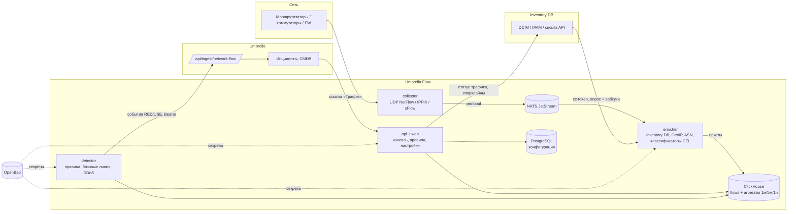

# Network Flow: план приложения

> **Статус: черновик.** Стек (раздел 5) ждёт согласования. После согласования план фиксируется, и начинается этап 0.

Приложение анализа сетевого трафика (NetFlow / IPFIX / sFlow) с возможностями Akvorado и ElastiFlow. Оно тесно
интегрировано с **Umbrella Monitoring** (зонтичный мониторинг, инциденты, CMDB) и **Inventory DB** (DCIM / IPAM в стиле
NetBox). Рабочее название — **Umbrella Flow**; ниже — «Flow».

## 1. Что уже есть: Umbrella Monitoring (ветка `dev`) и Inventory DB (`main`)

### Umbrella Monitoring (`dev`, на 273 коммита впереди `main`)

| Что | Как устроено | Что это значит для Flow |
|---|---|---|
| Стек | Go 1.26, `net/http`, pgx, CEL (`cel-go`); React 19 + TypeScript + Vite 6, Headless UI, lucide, motion, xyflow | Тот же стек для Flow, чтобы код, сборки и навыки переиспользовались |
| Хранение | PostgreSQL обязателен; конфигурация — снимком в `umbrella_state`, высокочастотные данные — в отдельных таблицах с секциями по дням | Конфигурацию Flow держим в PostgreSQL сразу реляционно; потоки — не в PostgreSQL (см. ClickHouse) |
| Секреты | Только OpenBao (KV v2, AppRole), в приложении ссылки `openbao://…`, кеш 30 с | Flow делает так же: mount `flow/`, AppRole `flow` |
| Приём событий | `POST /api/ingest/{slug}` → коннектор (граф узлов, CEL) → событие `{ci, signal, severity, status, title, labels}` → схлопывание по КЕ + сигналу | **Главная точка интеграции**: Flow шлёт события трафика в коннектор Umbrella по шаблону `network-flow` |
| Важность | P1 `critical` … P5 `info`, методы RED / USE | Сигналы Flow: `use.link.utilization`, `red.traffic.anomaly`, `red.ddos.*`, `use.exporter.silent` |
| КЕ | Поиск по ID, имени, короткому имени, IP, DNS-имени, псевдонимам; `source_refs` вида `inventory-db:dcim.device:100` | Flow передаёт в событии `source_ref` устройства Inventory DB — КЕ находится однозначно |
| Rule Engine | PromQL к Prometheus-совместимому источнику, `for`, порог | Flow может отдавать ряды по интерфейсам в Prometheus-формате (`/metrics` или remote write) — правила USE по трафику пишутся в Umbrella как обычно |
| Grafana | `/go/incidents/{id}/grafana` с переменными `var-ci`, `var-signal`… и окном ±10 мин | Аналогичная ссылка «Трафик» из карточки инцидента в Flow с фильтром по КЕ и окну времени |
| Доступ | Сессии, роли `<страница>:<функция>`, LDAP / AD, Entra ID, области видимости по сервисам. **API-токенов нет** | Flow не может читать каталог Umbrella по API без доработки Umbrella (раздел 7) |
| Интерфейс | RU / EN, светлая и тёмная темы, боковое меню с группами, плитки над таблицами, боковые карточки | Flow следует тому же дизайну (как Inventory DB, `docs/design.md`) |
| Деплой | Наборы Docker Compose в `deploy/*` в общей сети `umbrella` | Flow добавляет `deploy/flow` и `deploy/clickhouse` в ту же сеть |

### Inventory DB (`main`; ветки `dev` нет, `main` — самая свежая)

| Что | Как устроено | Что это значит для Flow |
|---|---|---|
| Стек | Node 22 + TypeScript, Fastify 5, pg, zod; React 19 + Vite 7, TanStack Query, react-router 7, Leaflet | Flow ходит в него только по REST |
| DCIM / IPAM | NetBox-совместимый REST `/api/v1/dcim|ipam|circuits|tenancy|virtualization`, токен `xc-token` | **Источник обогащения**: экспортёры = устройства с primary IP; интерфейсы (имя, описание, скорость, LAG, VLAN); префиксы, VRF, VLAN, арендаторы, площадки, теги, custom fields |
| Каналы связи | `circuits` с провайдером, `commit_rate`, `circuit-terminations` с кабелем к интерфейсу | **Автоматическая классификация интерфейсов** «внешний / транзит / пиринг / провайдер» без ручных правил; коммит для 95-го перцентиля и перерасхода |
| Кабели и трассировка | `cables`, `…/trace` | Граница «внутренний / внешний», соседи для карты связей |
| События | `netboxEvents` (created / updated / deleted) и вебхуки | Мгновенное обновление словарей обогащения вместо опроса раз в N минут |
| Интеграции | `nc_integrations` с `kind` (сейчас `umbrella`), лента КЕ, приём тревог по HMAC, `GET /integrations/umbrella/status` → чипы на устройствах | Новый `kind: flow`: чип и спарклайн трафика на устройстве и интерфейсе, ссылки «Открыть в Flow» |

## 2. Ключевые возможности аналогов

### Akvorado (Free, AGPL-3.0, Go + Vue + ClickHouse + Kafka)

- **Конвейер** inlet → Kafka → outlet → ClickHouse; orchestrator раздаёт конфигурацию и создаёт схему ClickHouse; console — веб-интерфейс.
- **Приём**: NetFlow v5/v9, IPFIX, sFlow; учёт частоты сэмплирования (в т.ч. переопределение), option templates.
- **Обогащение**: имена, описания и скорости интерфейсов по SNMP / gNMI; маршрутная информация (AS path, communities, next hop) по BMP или BioRIS; GeoIP и ASN (MaxMind / IPinfo); **классификаторы** экспортёров (группа, роль, площадка, регион, арендатор) и интерфейсов (граница internal / external, connectivity, provider) на собственном языке выражений; атрибуты сетей по префиксам (имя, роль, площадка, страна…).
- **Хранение**: ClickHouse, таблица сырых потоков + агрегаты 1 мин / 5 мин / 1 ч с разным TTL; автоматический выбор разрешения под период запроса.
- **Консоль**: «Visualize» — любые измерения (до N, остальное «Other»), графики stacked / lines / grid / **sankey**, двунаправленный режим (входящий и исходящий на одном графике), 95-й перцентиль, единицы bps / pps / % загрузки; **язык фильтров с автодополнением**; ссылки, воспроизводящие вид; страница экспортёров; виджеты главной (топ AS, порты, страны, «последние потоки»).
- **Эксплуатация**: внутренние метрики Prometheus, демо-экспортёр для тестов, Docker Compose.

### ElastiFlow (коммерческий Unified Flow Collector, Go; хранение в Elasticsearch / OpenSearch / Splunk / Kafka)

- **Приём**: NetFlow v1–v9, IPFIX, sFlow, **AWS / Azure / GCP flow logs**; большой словарь вендорских полей (Cisco AVC / NBAR, Palo Alto, Fortinet, Juniper, VMware NSX и др.).
- **Обогащение**: GeoIP, ASN, **обратный DNS** с кешем, **идентификация приложений** (порты IANA, NBAR, вендорские App-ID), **репутация IP / threat intelligence** (NetIntel), **пользовательские метаданные** для IP, сетей, экспортёров и интерфейсов из YAML / CSV, атрибуты интерфейсов из option records и SNMP.
- **Семантика потока**: определение клиента и сервера, «локальность» трафика (private / public, internal / external), сшивание направлений, длительность, TCP-флаги, задержки (если экспортёр их отдаёт).
- **Готовые дашборды**: обзор, топ собеседников, приложения, AS, гео-карта, угрозы, «потоки по экспортёру / интерфейсу», утилизация интерфейсов; поиск по сырым записям.
- **Unified SNMP Collector** — опрос интерфейсов и устройств рядом с потоками.
- **Безопасность**: выделение подозрительного трафика (сканы, известные вредоносные IP, необычные порты), передача в SIEM.

### Что берём в Flow

| Возможность | Источник идеи | Этап |
|---|---|---|
| Приём NetFlow v5/v9 / IPFIX / sFlow, сэмплирование, option templates | оба | 1 |
| Хранение в ClickHouse с агрегатами 1м / 5м / 1ч и TTL | Akvorado | 1 |
| Обогащение экспортёров, интерфейсов и сетей **из Inventory DB** вместо SNMP-опроса и ручных YAML | Akvorado (классификаторы) + ElastiFlow (метаданные) | 2 |
| Классификаторы на CEL (как в коннекторах Umbrella) | Akvorado | 2 |
| GeoIP / ASN (MaxMind GeoLite2 или IPinfo Lite) | оба | 2 |
| Консоль «Visualize»: измерения, sankey, stacked, двунаправленность, 95-й перцентиль, язык фильтров | Akvorado | 3 |
| Поиск по сырым потокам, топ собеседников, приложения | ElastiFlow | 3 |
| Определение приложения по портам и вендорским полям; клиент / сервер | ElastiFlow | 3 |
| Правила трафика → инциденты Umbrella, обнаружение DDoS и аномалий по базовой линии | собственное (у аналогов нет связки с инцидент-менеджментом) | 4 |
| Трафик на карточках устройств и интерфейсов Inventory DB, утилизация каналов против `commit_rate` | собственное | 5 |
| Обнаружение зависимостей сервисов по трафику → предложения связей в CMDB Umbrella | собственное | 5 |
| BMP (AS path, communities), SNMP / gNMI как запасной источник, обратный DNS | Akvorado / ElastiFlow | 6 |
| Threat intelligence (FireHOL, Spamhaus DROP, abuse.ch), облачные flow logs | ElastiFlow | 6 |

Код Akvorado (AGPL-3.0) и ElastiFlow (проприетарный) **не копируем** — только идеи, как с n8n в Umbrella. Декодирование
протоколов — на библиотеке goflow2 (BSD-3-Clause).

## 3. Архитектура

Один бинарник Go с подкомандами (`flow collector | enricher | detector | api | all`): для стенда — `all` в одном
контейнере, для нагрузки — роли раздельно и в нескольких экземплярах (collector — за UDP-балансировщиком, enricher —
consumer group JetStream).

### Модель данных ClickHouse (черновик)

- `flows` — MergeTree, секции по дням, `ORDER BY (TimeReceived, ExporterAddress, InIfName, OutIfName)`, TTL 7–15 дней.
  Поля: время, экспортёр (адрес, имя, площадка, роль, группа, арендатор), интерфейсы вход / выход (имя, описание,
  скорость, граница, провайдер, канал, VLAN), src / dst (адрес, порт, префикс, сеть, роль сети, арендатор, VRF, AS,
  страна, город), протокол, TCP-флаги, ToS / DSCP, приложение, направление клиент → сервер, bytes, packets,
  sampling rate, **`SrcCI` / `DstCI`** (source_ref Inventory DB) для связи с КЕ Umbrella.
- `flows_1m`, `flows_5m`, `flows_1h` — материализованные представления с SummingMergeTree по «низкокардинальным»
  измерениям, TTL 30 дней / 90 дней / 2 года.
- `if_counters_1m` — загрузка интерфейсов (bps / pps in / out) для правил и спарклайнов.
- Словари ClickHouse (`Dictionary` из PostgreSQL / HTTP): сети, экспортёры, интерфейсы, ASN, протоколы, приложения —
  чтобы переименование в Inventory DB сразу отражалось в истории без перезаписи.

### Конфигурация в PostgreSQL

Реляционные таблицы с миграциями (не снимок, как в Umbrella): подключения (Inventory DB, Umbrella, GeoIP), экспортёры и
переопределения сэмплирования, классификаторы, правила обнаружения, сохранённые виды консоли, пользователи, роли, журнал
аудита. Секреты — только ссылки на OpenBao.

## 4. Интеграции подробно

### 4.1. Inventory DB → Flow (обогащение)

| Данные Inventory DB | Что получает поток |
|---|---|
| `dcim/devices` с `primary_ip4/6`, OOB IP + IPAM-адреса интерфейсов | экспортёр: имя, площадка, роль, производитель / модель, арендатор, теги, `source_ref` |
| `dcim/interfaces` | имя, описание, скорость, LAG, режим VLAN; `ifIndex` ↔ имя — из option templates, SNMP или custom field `snmp_index` |
| `circuits` + `circuit-terminations` (кабель к интерфейсу) | граница `external`, провайдер, тип связности (транзит / пиринг / IX — по типу канала), `commit_rate` |
| `cables` / `trace` | граница `internal`, соседнее устройство |
| `ipam/prefixes` (+ VRF, VLAN, роль, арендатор, площадка, теги) | сеть src / dst: имя, роль, арендатор, площадка, VRF |
| `ipam/ip-addresses` (+ DNS-имя, назначенное устройство / ВМ) | `SrcCI` / `DstCI`, имя хоста без обратного DNS |
| custom fields и теги | дополнительные атрибуты для классификаторов CEL |

Синхронизация: полная загрузка по расписанию (по умолчанию 15 мин) + вебхуки `netboxEvents` для мгновенных изменений.
Что не найдено в Inventory DB (экспортёр без устройства, IP без префикса) — список «Неизвестные» с кнопкой «Создать в
Inventory DB» (через её API, право редактора).

### 4.2. Flow → Inventory DB (отображение)

Новый вид интеграции в Inventory DB `kind: flow` (по образцу `umbrella`):
- `GET /api/v1/integrations/flow/status?object_type=dcim.interface&ids=…` → загрузка in / out, % от скорости, ссылка.
- На странице устройства и интерфейса — спарклайн 24 ч и кнопка «Открыть трафик» (`/visualize?filter=…`).
- На странице канала — 95-й перцентиль за месяц против `commit_rate`.
- На странице префикса — фактически активные адреса (по потокам) против IPAM: «живые, но не учтённые» адреса.

### 4.3. Flow → Umbrella (инциденты)

- В Umbrella — новый шаблон коннектора `network-flow` в `internal/presets` и пункт «Flow» в диалоге «Подключить
  источник»; Flow при настройке получает адрес приёма и Bearer-токен (хранит в OpenBao).
- Detector Flow отправляет события firing / resolved в формате шаблона:
  `{id, ci, source_ref, signal, method: RED|USE, severity, status, title, value, labels, links: {flow}}`.
- Сигналы:

  | Сигнал | Метод | Условие (по умолчанию) | КЕ |
  |---|---|---|---|
  | `use.link.utilization` | USE | загрузка интерфейса > 85 % 5 мин | устройство интерфейса |
  | `use.link.commit` | USE | 95-й перцентиль канала > `commit_rate` | устройство / канал |
  | `red.ddos.volumetric` | RED | bps / pps на dst IP выше порога и базовой линии × k | dst-хост (по IPAM) или пограничный маршрутизатор |
  | `red.ddos.syn` | RED | доля SYN без ACK на dst > X % | то же |
  | `red.traffic.anomaly` | RED | отклонение от недельной базовой линии по интерфейсу / сети / сервису | устройство / КЕ |
  | `red.traffic.drop` | RED | трафик сервиса упал до нуля (обратная аномалия) | КЕ сервиса |
  | `use.exporter.silent` | USE | от экспортёра нет потоков N минут | экспортёр |
  | `sec.threat.contact` | RED | контакт с IP из списков угроз (этап 6) | внутренний хост |

- КЕ передаётся через `source_ref` Inventory DB (`inventory-db:dcim.device:100`) и имя / IP — Umbrella уже умеет
  находить КЕ по ним. Сервисные окна, маршрут и PagerDuty обрабатывает Umbrella — Flow этого не дублирует.
- Альтернатива для USE: Flow отдаёт `if_counters` в формате Prometheus, а правила пишутся в Rule Engine Umbrella.
  Обе схемы поддерживаем; по умолчанию — события из detector (у него есть базовые линии и DDoS).

### 4.4. Umbrella → Flow (контекст инцидента)

- Ссылка «Трафик» в карточке инцидента Umbrella → `flow/go/incident?ci=…&ip=…&from=…&to=…`: консоль открывается с
  фильтром по IP КЕ и окном ±30 мин, раскладка по собеседникам и портам — «кто нагрузил канал».
- Дашборд Grafana (плагин ClickHouse) «Трафик КЕ» с теми же переменными `var-ci`, `var-ci_id` для существующей
  настройки Grafana в Umbrella.
- (этап 5) Обнаружение зависимостей: устойчивые потоки КЕ ↔ КЕ → предложения связей «зависит от» на карте CMDB.

### 4.5. Общее

- **Вход**: LDAP / AD и Entra ID, как в Umbrella и Inventory DB; роли `<страница>:<функция>`. Область видимости по
  сервисам Umbrella — после появления в Umbrella API-токенов (раздел 7); до этого — по арендаторам / площадкам Inventory DB.
- **Секреты**: только OpenBao (KV v2, mount `flow/`; можно тот же экземпляр, что у Umbrella). Там хранятся пароли
  PostgreSQL и ClickHouse, учётные данные NATS, токены Inventory DB и Umbrella, пароль привязки LDAP, секрет Entra ID,
  ключи сессий и подписей, хеши паролей локальных пользователей (`users/<id>`, PBKDF2-SHA256, как в Umbrella). В
  PostgreSQL и `flow.json` — только ссылки `openbao://…`; в `flow.json` — адрес OpenBao и способ входа (AppRole из
  смонтированных файлов). API секреты не возвращает (только признак `*_set`), в журналы и аудит они не попадают;
  чтение с кешем 30 с, поэтому ротация в OpenBao не требует перезапуска.
- **Дизайн**: дизайн-система Umbrella (как в Inventory DB `docs/design.md`), RU / EN, светлая и тёмная темы.

## 5. Предлагаемый стек (на согласование)

| Слой | Выбор | Почему | Альтернатива |
|---|---|---|---|
| Backend | **Go 1.26** | как Umbrella; производительность UDP-приёма; общие подходы (OpenBao, CEL, pgx) | Rust — быстрее, но второй язык в экосистеме |
| Декодирование потоков | **goflow2** (BSD-3) | NetFlow v5/v9, IPFIX, sFlow, шаблоны, зрелая библиотека | свой декодер — дольше |
| Хранилище потоков | **ClickHouse 25.x** | колонки, сжатие 10–20×, агрегаты MV, словари, TTL; то же у Akvorado | OpenSearch (как ElastiFlow) — в 5–10 раз больше диска и памяти, слабее агрегации |
| Шина | **NATS JetStream** | лёгкая, уже в целевой архитектуре Umbrella, буфер при недоступности ClickHouse | Kafka / Redpanda — тяжелее; на малом стенде шину можно отключить (collector → enricher в процессе) |
| Конфигурация | **PostgreSQL 17** (тот же сервер, своя база `flow`), миграции **goose**, запросы **sqlc + pgx** | как у соседей, реляционно | — |
| Секреты | **OpenBao 2.7** | как у соседей | — |
| Выражения | **CEL (cel-go)** — классификаторы и условия правил | уже в Umbrella, знаком пользователям коннекторов | язык Akvorado (expr) |
| Язык фильтров консоли | свой PEG (**pigeon**) → SQL ClickHouse с параметрами | как в Akvorado: `SrcAS = 65000 AND InIfBoundary = external` | только конструктор фильтров |
| GeoIP / ASN | **MaxMind GeoLite2** или **IPinfo Lite** (MMDB), `oschwald/maxminddb-golang` | бесплатно, обновление по расписанию | — |
| Frontend | **React 19 + TypeScript + Vite** | как Umbrella и Inventory DB | — |
| Графики | **Apache ECharts** | sankey, stacked area, карты, большие ряды; использует Akvorado | Recharts — нет sankey и слабее на больших рядах |
| Данные во frontend | **TanStack Query**, **react-router 7** | как Inventory DB | — |
| Редактор фильтров | **CodeMirror 6** с автодополнением | подсветка и подсказки измерений / значений | — |
| UI-примитивы | Headless UI, lucide, motion, overlayscrollbars | как Umbrella | — |
| Метрики | Prometheus `/metrics` (prometheus/client_golang) | наблюдаемость самого Flow + ряды загрузки интерфейсов | — |
| Дашборды | Grafana 13 + **grafana-clickhouse-datasource** | контекст инцидента в существующей Grafana | — |
| Деплой | Docker Compose: `deploy/flow`, `deploy/clickhouse`, `deploy/nats` в сети `umbrella`; позже Helm | как у соседей | — |
| Тесты | `go test` + testcontainers (ClickHouse, PostgreSQL), Vitest, Playwright e2e; демо-экспортёр (генератор потоков) | | — |
| Лицензия | только открытые зависимости с пермиссивными лицензиями | требование из архитектурных принципов | — |

Ориентир по ресурсам (проверить на пилоте): 50 тыс. потоков/с ≈ 4 ядра на сбор и обогащение; ClickHouse ≈ 30–60 ГБ в
сутки сырых потоков после сжатия при сэмплировании 1:1000 на 100G-каналах — зависит от числа экспортёров.

## 6. Этапы

| Этап | Содержание | Готово, когда |
|---|---|---|
| **0. Основа** | репозиторий, Makefile, CI (lint, test, build образа), Docker Compose стенда (ClickHouse, NATS, PostgreSQL, OpenBao), мастер настройки как в Umbrella, вход, роли, дизайн-оболочка | стенд поднимается одной командой, вход работает |
| **1. Сбор** | collector (NetFlow v5/v9, IPFIX, sFlow), сэмплирование и его переопределение, option templates, реестр экспортёров, запись в ClickHouse пакетами, агрегаты 1м/5м/1ч, демо-экспортёр, метрики приёма | 50k fps на стенде без потерь, страница «Экспортёры» |
| **2. Обогащение** | подключение Inventory DB (токен в OpenBao), загрузка устройств / интерфейсов / префиксов / каналов, вебхуки, словари ClickHouse, GeoIP / ASN, классификаторы CEL с предпросмотром, «Неизвестные» | у потока заполнены экспортёр, интерфейсы, граница, провайдер, сети, AS, страна |
| **3. Консоль** | Visualize (измерения, sankey / stacked / lines / grid, двунаправленность, bps / pps / %, 95-й перцентиль), язык фильтров, сохранённые виды и ссылки, поиск по сырым потокам, топ-виджеты главной, приложения по портам | инженер находит «кто нагрузил канал» за 3 щелчка |
| **4. Umbrella** | detector (пороги, базовые линии, DDoS), шаблон коннектора `network-flow` в Umbrella, отправка событий с `source_ref`, ссылка «Трафик» из инцидента, дашборд Grafana, `/metrics` с загрузкой интерфейсов для Rule Engine | перегрузка канала на стенде даёт инцидент Umbrella на нужной КЕ со ссылкой на трафик |
| **5. Inventory DB** | `kind: flow` в Inventory DB: чипы и спарклайны на устройствах, интерфейсах и каналах, 95-й перцентиль против `commit_rate`, «живые, но не учтённые» адреса; предложения зависимостей для CMDB Umbrella | данные трафика видны в Inventory DB без перехода в Flow |
| **6. Расширения** | BMP (AS path, communities, next hop), SNMP / gNMI для устройств вне Inventory DB, обратный DNS, threat intelligence, облачные flow logs, HA и масштабирование, Helm | по приоритетам после пилота |

## 7. Что нужно поменять в соседних репозиториях

| Репозиторий | Изменение | Этап |
|---|---|---|
| Umbrella | шаблон коннектора `network-flow` и пункт «Flow» в «Подключить источник» | 4 |
| Umbrella | настройка «Адрес Flow» и ссылка «Трафик» в карточке инцидента и КЕ (по образцу Grafana) | 4 |
| Umbrella | **API-токены / сервисные учётные записи** (сейчас их нет) — чтобы Flow читал сервисы, команды и области видимости, а также предлагал связи CMDB | 5 |
| Inventory DB | вид интеграции `kind: flow`, чипы и спарклайны, custom field `snmp_index` у интерфейсов | 2, 5 |
| Inventory DB | (по желанию) вебхук на изменения DCIM / IPAM в Flow вместо опроса | 2 |

## 8. Вопросы для согласования

1. Стек из раздела 5 — особенно **ClickHouse** вместо OpenSearch и **NATS JetStream** вместо Kafka.
2. Ожидаемый объём: число экспортёров, потоков в секунду, производители оборудования (Cisco, Juniper, Huawei, Eltex,
   MikroTik, FortiGate…), есть ли BGP-пограничные маршрутизаторы (нужен ли BMP).
3. Срок хранения сырых потоков и агрегатов.
4. GeoIP: MaxMind GeoLite2 (нужна бесплатная учётная запись) или IPinfo Lite.
5. Название приложения и отдельный ли это репозиторий `Network` (предполагается да).
