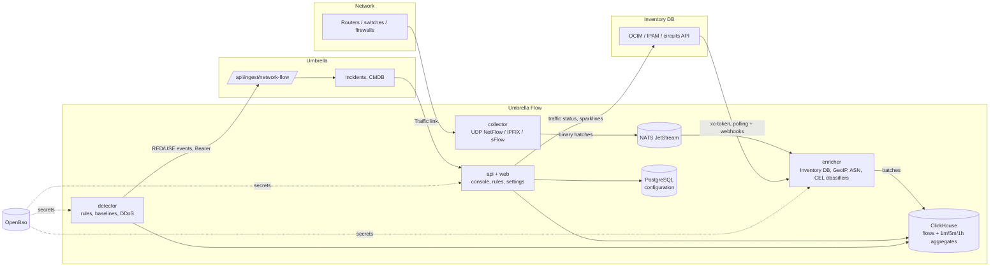

# Umbrella Flow: application plan

> **Status: in progress.** The stack in section 5 was adopted with the proposed defaults (ClickHouse, NATS JetStream,
> MMDB-based GeoIP). Requirements added by the owner: Docker-based deployment, a first-run setup wizard, every secret in
> OpenBao, all documentation in English.

A network traffic analysis application (NetFlow / IPFIX / sFlow) with the capabilities of Akvorado and ElastiFlow,
tightly integrated with **Umbrella Monitoring** (umbrella monitoring, incidents, CMDB) and **Inventory DB** (NetBox-style
DCIM / IPAM). Working name: **Umbrella Flow** ("Flow" below).

## 1. What already exists: Umbrella Monitoring (`dev` branch) and Inventory DB (`main`)

### Umbrella Monitoring (`dev`, 273 commits ahead of `main`)

| Area | How it works | What it means for Flow |
|---|---|---|
| Stack | Go 1.26, `net/http`, pgx, CEL (`cel-go`); React 19 + TypeScript + Vite 6, Headless UI, lucide, motion, xyflow | Same stack for Flow so code, builds and skills carry over |
| Storage | PostgreSQL is required; configuration is a snapshot in `umbrella_state`, high-frequency data lives in separate day-partitioned tables | Flow keeps its configuration in PostgreSQL, relational from the start; flows do not go to PostgreSQL (see ClickHouse) |
| Secrets | OpenBao only (KV v2, AppRole), the app keeps `openbao://…` references, 30 s cache | Flow does the same: mount `flow/`, AppRole `flow` |
| Event intake | `POST /api/ingest/{slug}` → connector (node graph, CEL) → event `{ci, signal, severity, status, title, labels}` → deduplication by CI + signal | **The main integration point**: Flow sends traffic events to an Umbrella connector built from the `network-flow` preset |
| Severity | P1 `critical` … P5 `info`, RED / USE methods | Flow signals: `use.link.utilization`, `red.traffic.anomaly`, `red.ddos.*`, `use.exporter.silent` |
| CIs | Matched by ID, name, short name, IP, DNS name, aliases; `source_refs` such as `inventory-db:dcim.device:100` | Flow puts the Inventory DB device `source_ref` into each event, so the CI is found unambiguously |
| Rule Engine | PromQL against a Prometheus-compatible source, `for`, threshold | Flow can expose per-interface series in Prometheus format, so USE rules on traffic can be written in Umbrella as usual |
| Grafana | `/go/incidents/{id}/grafana` with `var-ci`, `var-signal`… and a ±10 min window | A matching "Traffic" link from the incident card into Flow, filtered by CI and time window |
| Access | Sessions, `<page>:<function>` roles, LDAP / AD, Entra ID, service-based visibility scopes. **No API tokens** | Flow cannot read Umbrella's catalogue through the API until Umbrella adds them (section 7) |
| UI | RU / EN, light and dark themes, grouped sidebar, tiles above tables, side-panel cards | Flow follows the same design (as Inventory DB does, `docs/design.md`) |
| Deployment | Docker Compose sets in `deploy/*` on the shared `umbrella` network | Flow ships its own Docker Compose stack that can join the same network |

### Inventory DB (`main`; there is no `dev` branch, `main` is the latest)

| Area | How it works | What it means for Flow |
|---|---|---|
| Stack | Node 22 + TypeScript, Fastify 5, pg, zod; React 19 + Vite 7, TanStack Query, react-router 7, Leaflet | Flow talks to it over REST only |
| DCIM / IPAM | NetBox-compatible REST `/api/v1/dcim|ipam|circuits|tenancy|virtualization`, `xc-token` auth | **Enrichment source**: exporters = devices with a primary IP; interfaces (name, description, speed, LAG, VLAN); prefixes, VRFs, VLANs, tenants, sites, tags, custom fields |
| Circuits | `circuits` with provider and `commit_rate`, `circuit-terminations` cabled to an interface | **Automatic interface classification** (external / transit / peering / provider) without hand-written rules; commit rate for 95th-percentile and overage checks |
| Cables and tracing | `cables`, `…/trace` | Internal / external boundary, neighbours for the link map |
| Events | `netboxEvents` (created / updated / deleted) and webhooks | Immediate refresh of the enrichment data instead of polling every N minutes |
| Integrations | `nc_integrations` with a `kind` (currently `umbrella`), CI feed, HMAC-signed alert intake, `GET /integrations/umbrella/status` → device chips | A new `kind: flow`: traffic chip and sparkline on devices and interfaces, "Open in Flow" links |

## 2. Key features of the reference products

### Akvorado (free, AGPL-3.0, Go + Vue + ClickHouse + Kafka)

- **Pipeline** inlet → Kafka → outlet → ClickHouse; the orchestrator distributes configuration and creates the ClickHouse
  schema; the console is the web UI.
- **Intake**: NetFlow v5/v9, IPFIX, sFlow; sampling rate handling (including overrides), option templates.
- **Enrichment**: interface names, descriptions and speeds via SNMP / gNMI; routing data (AS path, communities, next hop)
  via BMP or BioRIS; GeoIP and ASN (MaxMind / IPinfo); **classifiers** for exporters (group, role, site, region, tenant)
  and interfaces (internal / external boundary, connectivity, provider) in its own expression language; network
  attributes by prefix (name, role, site, country…).
- **Storage**: ClickHouse, a raw flows table plus 1 min / 5 min / 1 h aggregates with different TTLs; automatic choice of
  resolution for the requested period.
- **Console**: "Visualize" — any dimensions (top N, the rest as "Other"), stacked / lines / grid / **sankey** graphs,
  bidirectional mode (in and out on one graph), 95th percentile, bps / pps / % utilisation units; **filter language with
  completion**; links that reproduce a view; exporters page; home widgets (top AS, ports, countries, last flows).
- **Operations**: internal Prometheus metrics, a demo exporter for testing, Docker Compose.

### ElastiFlow (commercial Unified Flow Collector, Go; storage in Elasticsearch / OpenSearch / Splunk / Kafka)

- **Intake**: NetFlow v1–v9, IPFIX, sFlow, **AWS / Azure / GCP flow logs**; a large dictionary of vendor fields (Cisco
  AVC / NBAR, Palo Alto, Fortinet, Juniper, VMware NSX, etc.).
- **Enrichment**: GeoIP, ASN, cached **reverse DNS**, **application identification** (IANA ports, NBAR, vendor App-IDs),
  **IP reputation / threat intelligence** (NetIntel), **user-defined metadata** for IPs, networks, exporters and
  interfaces from YAML / CSV, interface attributes from option records and SNMP.
- **Flow semantics**: client / server detection, traffic locality (private / public, internal / external), direction
  stitching, duration, TCP flags, latency (when the exporter provides it).
- **Ready-made dashboards**: overview, top talkers, applications, AS, geo map, threats, flows by exporter / interface,
  interface utilisation; search over raw records.
- **Unified SNMP Collector** — device and interface polling next to the flows.
- **Security**: highlights suspicious traffic (scans, known-bad IPs, unusual ports), forwards to a SIEM.

### What Flow takes from them

| Feature | Idea from | Stage |
|---|---|---|
| NetFlow v5/v9 / IPFIX / sFlow intake, sampling, option templates | both | 1 |
| ClickHouse storage with 1m / 5m / 1h aggregates and TTLs | Akvorado | 1 |
| Exporter, interface and network enrichment **from Inventory DB** instead of SNMP polling and hand-written YAML | Akvorado (classifiers) + ElastiFlow (metadata) | 2 |
| CEL classifiers (as in Umbrella's connectors) | Akvorado | 2 |
| GeoIP / ASN (MaxMind GeoLite2 or IPinfo Lite) | both | 2 |
| "Visualize" console: dimensions, sankey, stacked, bidirectional, 95th percentile, filter language | Akvorado | 3 |
| Raw flow search, top talkers, applications | ElastiFlow | 3 |
| Application detection by port and vendor fields; client / server | ElastiFlow | 3 |
| Traffic rules → Umbrella incidents, DDoS and baseline anomaly detection | our own (neither product connects to incident management) | 4 |
| Traffic on Inventory DB device and interface pages, circuit utilisation against `commit_rate` | our own | 5 |
| Service dependency discovery from traffic → relation proposals for Umbrella's CMDB | our own | 5 |
| BMP (AS path, communities), SNMP / gNMI as a fallback source, reverse DNS | Akvorado / ElastiFlow | 6 |
| Threat intelligence (FireHOL, Spamhaus DROP, abuse.ch), cloud flow logs | ElastiFlow | 6 |

We **do not copy** code from Akvorado (AGPL-3.0) or ElastiFlow (proprietary) — ideas only, as Umbrella did with n8n.
Protocol decoding uses the goflow2 library (BSD-3-Clause).

## 3. Architecture

One Go binary with roles (`collector | enricher | detector | api | all`): `all` in one container for small installs;
for load, roles run separately and in several instances (collectors behind a UDP load balancer, enrichers as a
JetStream consumer group).

### ClickHouse data model

- `flows` — MergeTree, partitioned by day, `ORDER BY (toStartOfFiveMinutes(TimeReceived), ExporterAddress, InIfName,
  OutIfName, TimeReceived)`, TTL 15 days by default. Columns: time, exporter (address, name, site, role, group,
  tenant), input / output interfaces (name, description, speed, boundary, provider, circuit), src / dst (address, port,
  prefix, network, network role, tenant, VRF, AS, country, city), protocol, TCP flags, ToS / DSCP, application, bytes,
  packets, sampling rate, **`SrcCI` / `DstCI`** (Inventory DB source_ref) to link to Umbrella CIs. Bytes and packets are
  stored multiplied by the sampling rate.
- `flows_1m`, `flows_5m`, `flows_1h` — SummingMergeTree tables fed by materialised views over the low-cardinality
  dimensions, TTL 30 days / 90 days / 2 years.
- The column registry (`internal/schema`) is the single source for the DDL, the writer, the filter language and the
  console.

### Configuration in PostgreSQL

Relational tables with migrations (not a snapshot as in Umbrella): connections (Inventory DB, Umbrella, GeoIP), sampling
overrides, classifiers, detection rules, saved console views, users, roles, audit log. Secrets are only OpenBao
references.

## 4. Integrations in detail

### 4.1. Inventory DB → Flow (enrichment)

| Inventory DB data | What the flow gets |
|---|---|
| `dcim/devices` with `primary_ip4/6` + IPAM addresses on its interfaces | exporter: name, site, region, role, manufacturer / model, tenant, tags, `source_ref` |
| `dcim/interfaces` | name, description, speed, LAG, VLAN mode; `ifIndex` ↔ name from option templates or the `snmp_index` custom field |
| `circuits` + `circuit-terminations` (cabled to an interface) | `external` boundary, provider, connectivity (transit / peering / IX by circuit type), `commit_rate` |
| `cables` / link peers | `internal` boundary, neighbour device |
| `ipam/prefixes` (+ VRF, VLAN, role, tenant, site, tags) | src / dst network: name, role, tenant, site, VRF |
| `ipam/ip-addresses` (+ DNS name, assigned device / VM) | `SrcCI` / `DstCI`, host name without reverse DNS |
| custom fields and tags | extra attributes for the CEL classifiers |

Synchronisation: a full load on a schedule (15 min by default) plus `netboxEvents` webhooks for immediate changes.
Whatever is missing from Inventory DB (an exporter without a device, an address outside any prefix) is listed under
"Unknown", with a "Create in Inventory DB" action (through its API, editor permission).

Notes from the implementation: devices have no OOB IP field; the `snmp_index` custom field must first be defined for
`dcim.interface`; interface speed and `commit_rate` are in Kbps; regions come from the site.

### 4.2. Flow → Inventory DB (display)

A new Inventory DB integration kind `kind: flow` (modelled on `umbrella`):
- `GET /api/v1/integrations/flow/status?object_type=dcim.interface&ids=…` → in / out load, % of speed, link.
- Device and interface pages show a 24 h sparkline and an "Open traffic" button (`/visualize?…`).
- Circuit pages show the monthly 95th percentile against `commit_rate`.
- Prefix pages show addresses that are active in flows but missing from IPAM.

### 4.3. Flow → Umbrella (incidents)

- Umbrella gets a `network-flow` connector preset in `internal/presets` and an "Umbrella Flow" entry in the "Connect
  source" dialog; during setup Flow receives the ingest URL and a Bearer token (stored in OpenBao).
- Flow's detector sends firing / resolved events in the preset's format:
  `{id, ci, source_ref, ip, signal, method: RED|USE, severity, status, title, value, labels, links: {flow}}`.
- Signals:

  | Signal | Method | Default condition | CI |
  |---|---|---|---|
  | `use.link.utilization` | USE | interface load > 85 % for 5 min | the interface's device |
  | `use.link.commit` | USE | circuit 95th percentile > `commit_rate` | device / circuit |
  | `red.ddos.volumetric` | RED | bps / pps to a dst IP above the threshold and above baseline × k | dst host (from IPAM) or the edge router |
  | `red.ddos.syn` | RED | share of SYN without ACK to a dst > X % | same |
  | `red.traffic.anomaly` | RED | deviation from the weekly baseline per interface / network / service | device / CI |
  | `red.traffic.drop` | RED | a service's traffic drops to zero (inverse anomaly) | the service's CI |
  | `use.exporter.silent` | USE | no flows from an exporter for N minutes | exporter |
  | `sec.threat.contact` | RED | contact with an IP from threat lists (stage 6) | internal host |

- The CI is identified by the Inventory DB `source_ref` (`inventory-db:dcim.device:100`) plus name / IP; Umbrella
  matches CIs by these. Maintenance windows, routing and PagerDuty stay in Umbrella — Flow does not duplicate them.
- USE alternative: Flow exposes interface utilisation in Prometheus format and the rules live in Umbrella's Rule
  Engine. Both are supported; detector events are the default (they have baselines and DDoS detection).

### 4.4. Umbrella → Flow (incident context)

- The "Traffic" link in an Umbrella incident card → `flow/go/incident?ci=…&ip=…&ref=…&from=…&to=…`: the console opens
  filtered by the CI's IP with a window from 30 minutes before the incident, broken down by talkers and ports — "who
  filled the link".
- A Grafana dashboard (ClickHouse plugin) "CI traffic" with the same `var-ci`, `var-ci_id` variables, for Umbrella's
  existing Grafana setting.
- (stage 5) Dependency discovery: steady CI ↔ CI flows → "depends on" relation proposals for the CMDB map.

### 4.5. Common

- **Sign-in**: LDAP / AD and Entra ID, as in Umbrella and Inventory DB; `<page>:<function>` roles. Visibility by
  Umbrella services comes once Umbrella has API tokens (section 7); until then, by Inventory DB tenants / sites.
- **Secrets**: OpenBao only (KV v2, mount `flow/`; may be the same instance as Umbrella's). It holds the PostgreSQL and
  ClickHouse passwords, NATS credentials, Inventory DB and Umbrella tokens, the LDAP bind password, the Entra ID secret,
  session and signing keys, and local users' password hashes (`users/<id>`, PBKDF2-SHA256, as in Umbrella). PostgreSQL
  and `flow.json` hold only `openbao://…` references; `flow.json` holds the OpenBao address and auth method (AppRole from
  mounted files). The API never returns secrets (only a `*_set` flag), and they never reach logs or the audit log;
  reads are cached for 30 s, so rotating a secret in OpenBao needs no restart.
- **Setup**: a first-run wizard as in Umbrella (see `docs/api.md`): setup code, general settings, OpenBao, PostgreSQL,
  ClickHouse, bus, collection ports, optional Inventory DB / Umbrella / GeoIP, administrator, review.
- **Deployment**: Docker. One image runs any role; one Docker Compose stack brings up Flow, ClickHouse, NATS,
  PostgreSQL and OpenBao (with automatic init / unseal) and can join the `umbrella` network.
- **Design**: Umbrella's design system (as in Inventory DB `docs/design.md`), RU / EN UI, light and dark themes.
- **Documentation**: English only (READMEs, docs, code comments, license). The UI stays bilingual.

## 5. Stack

| Layer | Choice | Why | Alternative |
|---|---|---|---|
| Backend | **Go 1.26** | as Umbrella; UDP intake performance; shared approaches (OpenBao, CEL, pgx) | Rust — faster, but a second language in the ecosystem |
| Flow decoding | **goflow2** (BSD-3) | NetFlow v5/v9, IPFIX, sFlow, templates, mature | own decoder — slower to build |
| Flow storage | **ClickHouse 25.8 LTS** | columnar, 10–20× compression, MV aggregates, TTL; same as Akvorado | OpenSearch (as ElastiFlow) — 5–10× more disk and memory, weaker aggregations |
| Bus | **NATS JetStream** | lightweight, already in Umbrella's target architecture, buffers while ClickHouse is down | Kafka / Redpanda — heavier; small installs can use the in-process queue |
| Configuration | **PostgreSQL 17** (same server, own `flow` database), **goose** migrations, **pgx** | as the sibling apps, relational | — |
| Secrets | **OpenBao 2.7** | as the sibling apps | — |
| Expressions | **CEL (cel-go)** for classifiers and rule conditions | already in Umbrella, familiar to connector authors | Akvorado's expr language |
| Console filter language | hand-written recursive-descent parser → ClickHouse SQL | as in Akvorado: `SrcAS = 65000 AND InIfBoundary = external` | filter builder only |
| GeoIP / ASN | **MaxMind GeoLite2** or **IPinfo Lite** (MMDB), `oschwald/maxminddb-golang` | free, scheduled updates | — |
| Frontend | **React 19 + TypeScript + Vite** | as Umbrella and Inventory DB | — |
| Charts | **Apache ECharts** | sankey, stacked area, maps, large series; Akvorado uses it | Recharts — no sankey, weaker on large series |
| Frontend data | **TanStack Query**, **react-router 7** | as Inventory DB | — |
| Filter editor | **CodeMirror 6** with completion | highlighting and dimension / value hints | — |
| UI primitives | Headless UI, lucide, motion, overlayscrollbars | as Umbrella | — |
| Metrics | Prometheus `/metrics` (prometheus/client_golang) | Flow's own observability + interface utilisation series | — |
| Dashboards | Grafana 13 + **grafana-clickhouse-datasource** | incident context in the existing Grafana | — |
| Deployment | **Docker**: one image, Docker Compose stack in `deploy/flow`, joins the `umbrella` network; Helm chart in `deploy/helm/umbrella-flow` | as the sibling apps | — |
| Tests | `go test` against real ClickHouse / PostgreSQL / NATS, Vitest, Playwright; demo exporter (flow generator) | | — |
| Dependencies | open-source dependencies with permissive licences only | architecture principle | — |

Resource estimate (to verify in a pilot): 50k flows/s ≈ 4 cores for collection and enrichment; ClickHouse ≈ 30–60 GB
per day of raw flows after compression at 1:1000 sampling on 100G links — depends on the number of exporters.

## 6. Stages

| Stage | Content | Done when |
|---|---|---|
| **0. Foundation** | repository, Makefile, CI (lint, test, image build), Docker Compose stack (ClickHouse, NATS, PostgreSQL, OpenBao), setup wizard as in Umbrella, sign-in, roles, design shell | the stack starts with one command, sign-in works |
| **1. Collection** | collector (NetFlow v5/v9, IPFIX, sFlow), sampling and overrides, option templates, exporter registry, batched ClickHouse writes, 1m/5m/1h aggregates, demo exporter, intake metrics | 50k fps on the test stack without loss, Exporters page |
| **2. Enrichment** | Inventory DB connection (token in OpenBao), devices / interfaces / prefixes / circuits, webhooks, GeoIP / ASN, CEL classifiers with preview, "Unknown" lists | flows carry exporter, interfaces, boundary, provider, networks, AS, country |
| **3. Console** | Visualize (dimensions, sankey / stacked / lines / grid, bidirectional, bps / pps / %, 95th percentile), filter language, saved views and links, raw flow search, home widgets, applications by port | an engineer finds "who filled the link" in 3 clicks |
| **4. Umbrella** | detector (thresholds, baselines, DDoS), `network-flow` connector preset in Umbrella, events with `source_ref`, "Traffic" link from incidents, Grafana dashboard, `/metrics` with interface utilisation for the Rule Engine | a link overload on the test stack raises an Umbrella incident on the right CI with a traffic link |
| **5. Inventory DB** | `kind: flow` in Inventory DB: chips and sparklines on devices, interfaces and circuits, 95th percentile against `commit_rate`, live-but-unrecorded addresses; dependency proposals for Umbrella's CMDB | traffic data is visible in Inventory DB without opening Flow |
| **6. Extensions** | BMP (AS path, communities, next hop), SNMP / gNMI for devices outside Inventory DB, reverse DNS, threat intelligence, cloud flow logs, HA and scaling, Helm | prioritised after the pilot. Done: reverse DNS (async PTR → `SrcHostPTR` / `DstHostPTR`), threat intelligence (public blocklists → `SrcThreat` / `DstThreat`, `sec.threat.contact`), cloud flow logs (AWS VPC / Firehose, Azure NSG / VNet, GCP Pub/Sub ingest endpoints), SNMP v2c / v3 fallback for interface names and speeds, BMP receiver (AS path, communities, large communities, next hop, routing-based SrcAS / DstAS), Helm chart (`deploy/helm/umbrella-flow`, all-in-one or split roles) — see `app/README.md` and `docs/api.md`. BMP VPNv4 / VPNv6 (a table per RD, lookups in the VRF of the input interface) and Adj-RIB-Out skipping. Open: gNMI, HA (BMP routes live in one enricher) |

## 7. Changes needed in the sibling repositories

| Repository | Change | Stage | Status |
|---|---|---|---|
| Umbrella | `network-flow` connector preset and "Umbrella Flow" in "Connect source" | 4 | done (branch `claude/akvorado-elasticflow-integration-onlhht`) |
| Umbrella | "Umbrella Flow address" setting and "Traffic" links on incident and CI cards (modelled on Grafana) | 4 | done (same branch) |
| Umbrella | **API tokens / service accounts** so Flow can read services, teams and visibility scopes and propose CMDB relations | 5 | done (same branch); verified end to end (`app/README.md`) |
| Inventory DB | `kind: flow` integration, chips and sparklines; `snmp_index` custom field on interfaces | 2, 5 | done (same branch); verified end to end |
| Inventory DB | (optional) webhook to Flow on DCIM / IPAM changes instead of polling | 2 | done: signed hook + early sync (integrations.md §2.2); verified end to end |

## 8. Open questions

1. Expected volume: number of exporters, flows per second, equipment vendors (Cisco, Juniper, Huawei, Eltex, MikroTik,
   FortiGate…), whether there are BGP edge routers (is BMP needed).
2. Retention for raw flows and aggregates (defaults: 15 days / 30 days / 90 days / 2 years).
3. GeoIP: MaxMind GeoLite2 (needs a free account) or IPinfo Lite.
